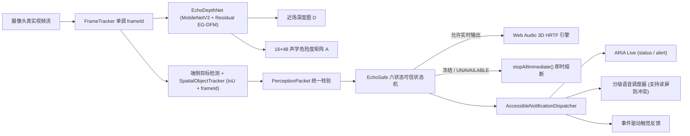

# 中国发明专利技术交底书

---

## 一、发明名称
**一种基于残差边缘引导深度融合与可信状态机控制的视障三维空间声场生成方法及系统**

## 二、所属技术领域
本发明涉及计算机视觉、感官替代（Sensory Substitution）、实时双耳空间音频合成与无障碍辅助感知技术领域，具体涉及一种面向视障人群的端侧轻量化单目深度-声学联合推理网络（EchoDepthNet）、Web Audio 3D HRTF 双耳空间声场渲染引擎及全链路失效保护状态机控制方法。

---

## 三、背景技术
全球及我国存在庞大视障群体。现有面向视障人士的视觉辅助软件或穿戴原型主要存在以下四类共性技术缺陷：

1. **视觉特征与声学映射割裂**：传统感官替代方案（如 The vOICe）仅基于二维灰度或静态边缘直接映射为高频扫频噪声，缺乏近场深度感知，背景纹理噪声极易淹没近距离真实障碍物；而纯目标检测转语音方案仅能输出离散类别名称，无法表达空间轮廓与连续方位。
2. **轻量化单目深度网络在障碍物边缘模糊**：现有移动端单目深度估计模型在低算力设备上为了压缩参数量，往往丢失高频结构边界，导致障碍物边缘平滑拖尾、近距离边界定位不准；若直接串联无残差保护的门控边缘融合模块，又易在浅层引发特征幅值衰减与梯度退化。
3. **缺乏全链路失效保护与防重复帧伪确认机制**：现有浏览器或移动端助行原型在摄像头画面冻结、权限撤销、页面切入后台或帧率低于推理频率时，常对同一旧视频帧重复推理，误将单帧抖动当作多帧连续确认，甚至在感知不可用时仍持续播放过期环境声场或在空检测时输出“前方安全”的误导性描述。
4. **多通道无障碍反馈冲突与无声失效**：当视障用户同时开启系统级读屏器（VoiceOver/TalkBack）与网页内置语音合成（TTS）时，两套语音引擎同时发声造成严重听觉冲突；若简单屏蔽内置 TTS，又可能导致自动环境识别更新无法同步至 ARIA Live 区域，或在不支持振动的设备上出现画面冻结无声失效。

---

## 四、发明内容

### （一）所要解决的技术问题
本发明旨在解决现有视障视觉辅助系统“深度与声场割裂、轻量化边缘融合退化、低帧率同帧重复推理与冻结残留声场、以及读屏防冲突与失效反馈丢失”的技术难题，提供一种高可靠、低认知负担、可端侧实时运行的三维空间声场生成方法及系统。

### （二）技术方案
本发明提供一种基于残差边缘引导深度融合与可信状态机控制的视障三维空间声场生成方法，包括如下核心步骤：

1. **真实视频帧单调身份标记与单并发采集**：
   优先监听浏览器 `requestVideoFrameCallback`（回退检测 `video.currentTime` 真实变化），仅为真正推进的新摄像头画面分配单调递增的整数帧标识 `frameId` 及采集时间戳 `capturedAt`；推理调度器通过单并发锁（`SingleFlightRunner`）与帧认领器（`FrameTracker`）确保同一 `frameId` 最多执行一次神经网络推理，彻底杜绝低帧率摄像头下的同帧重复推理。
2. **基于残差边缘引导深度融合（Residual EG-DFM）的双头轻量化推理网络（EchoDepthNet）**：
   - 在网络内部嵌入可微 Rec.709 亮度与 Sobel 梯度先验层（`DifferentiableSobelPrior`），提取输入 RGB 图像的高频结构边缘图 $E \in [0,1]^{1 \times H \times W}$；
   - 以轻量化 MobileNetV3-Small 作为四尺度编码器提取特征 $\{F_1, F_2, F_3, F_4\}$；
   - 在轻量特征金字塔解码器的每一级引入 **残差边缘引导深度融合模块（Residual EG-DFM）**：通过恒等或 $1\times 1$ 卷积快捷分支保留低频全局深度语义 $I = \mathcal{S}(F)$，在残差支路拼接多尺度双线性缩放后的边缘图 $E_k$，经深度可分离卷积提取边缘增强特征 $U$，并由通道-边缘联合门控 $G = \sigma(\text{Conv}_{1\times 1}([U, E_k]))$ 调制后以可学习残差缩放因子 $\gamma$ 注入主干：
     $$D_k = \text{SiLU}\big(\mathcal{S}(F_k) + \gamma \cdot (U \odot G)\big)$$
   - 解码器末级并行连接两个输出头：**稠密近场逆深度头**输出归一化接近度图 $\hat{D} \in [0,1]^{1 \times H \times W}$；**声学空间危险度头**将结构特征 $D_1$ 与近场深度特征拼接后经自适应池化直接预测与前端对齐的 $16 \times 48$ 声学危险度矩阵 $\hat{A} \in [0,1]^{1 \times 16 \times 48}$。
   - 训练阶段采用复合损失函数 $\mathcal{L} = \mathcal{L}_{\text{SI-Depth}} + \lambda_g \mathcal{L}_{\text{Grad}} + \lambda_a \mathcal{L}_{\text{Acoustic}}$，其中声学监督目标 $A^*$ 融合近场非线性加权与深度边界梯度：$A^* = \text{Pool}_{16\times 48}(\text{clip}(0.65 D^{1.35} + 0.35 |\nabla D|, 0, 1))$。
3. **基于 IoU 与独立帧 ID 的多目标追踪及统一数据包校验**：
   结合端侧目标检测结果，使用空间多目标追踪器（`SpatialObjectTracker`）依据检测框 IoU（$\ge 0.2$）、归一化中心距（$\le 14\%$ 对角线）及严格递增的 `frameId` 维护多目标独立轨迹；所有实时结果封装为携带会话代数 `sessionId`、必填正整数 `frameId`、采集/推理/过期时间戳的统一感知数据包（`PerceptionPacket`），并经 `isPerceptionPacketUsable` 执行全链路有效性、时间单调序与新鲜度验证。
4. **六状态可信状态机（EchoSafe）与三维 HRTF 连续声场即时熔断**：
   实时评估 `IDLE / INITIALIZING / ACTIVE / DEGRADED / UNAVAILABLE / DEMO` 六状态，严格隔离真实摄像头数据与模拟演示数据；前端 Web Audio 引擎将 $16 \times 48$ 声学矩阵按列映射至 $\pm 68^\circ$ 双耳 HRTF 方位角（水平坐标 $x \to$ 方位角、垂直坐标 $y \to$ 五声/对数音高、能量值 $\to$ 响度）。一旦检测到画面冻结（超过 `frameStaleMs` 无新帧）、视频轨道断开、页面切入后台或系统进入 `UNAVAILABLE`，立即经 `canEmitContinuousSpatialAudio` 阻断扫描并调用 `stopAllImmediate()` 停止并断开所有活跃音频振荡器节点。
5. **解耦式无障碍多通道通知分发与读屏防冲突协调**：
   建立独立于浏览器 TTS 接受状态的无障碍通知分发器（`AccessibleNotificationDispatcher`）及状态跃迁规划器（`planEchoSafeTransition`）：
   - 当用户开启读屏器防冲突模式时，抑制网页内置 `window.speechSynthesis` 避免与 VoiceOver/TalkBack 双重语音打架，同时保证所有有效环境识别与主动查询仍经去重冷却后送达持久挂载的 `role="status"`（`aria-live="polite"`）区域；
   - 当系统从运行态跃迁至 `UNAVAILABLE`（如视频冻结）时，统一联动 `role="alert"`（`aria-live="assertive"`）、紧急语音提示与事件驱动触觉振动脉冲，且在持续故障期间抑制 1 秒巡检重复刷屏；
   - 配合会话代次绑定的屏幕常亮锁管理器（`ScreenWakeLockController`），防止行进中自动息屏，并在会话停止时自动释放迟到返回的常亮锁。

### （三）有益效果
1. **边缘清晰且无梯度退化**：残差边缘引导深度融合模块在几乎不增加参数量（约 1.11M，增量 < 3%）的前提下，显著消除无残差门控导致的深度预测退化，在 AbsRel、RMSE、$\delta_1$ 及声学矩阵 RMSE 四项指标上全面优于无边缘融合基线。
2. **杜绝虚假安全感与过期声场残留**：通过单调 `frameId` 防同帧重复推理、必填 `frameId` 数据契约及 `UNAVAILABLE` 即时音频熔断，确保视障用户在画面冻结、断流或后台切出时绝不会继续听见过期环境声场或收到虚假安全承诺。
3. **非视觉独立交互可靠**：解耦式无障碍通知分发彻底解决了读屏器防冲突模式丢消息与无振动设备冻结无声失效问题，显著降低视障用户的听觉认知负担。

---

## 五、权利要求书（供专利代理师定稿参考）

1. 一种视障三维空间声场生成方法，其特征在于，包括以下步骤：
   - S1：采集真实摄像头视频流，仅为真正推进的新视频帧分配单调递增的帧标识 `frameId` 与采集时间戳，并通过单并发帧认领机制保证同一 `frameId` 最多执行一次神经网络推理；
   - S2：将新视频帧输入双头轻量化深度-声学联合网络，所述网络包含内置可微 Sobel 边缘先验层、多尺度轻量编码器、以及在解码器各级引入的残差边缘引导深度融合模块，其中所述残差边缘引导深度融合模块通过快捷分支保留低频深度语义、在残差支路拼接多尺度边缘图并经通道-边缘联合门控及可学习残差缩放因子进行高频边界细化，并行输出归一化近场深度图与 $M \times N$ 声学空间危险度矩阵；
   - S3：基于当前系统六状态可信状态机对摄像头权限、视频轨道存活、新帧新鲜度、推理时效及页面前后台可见性进行实时校验，并将检测结果封装为包含会话代次、必填正整数 `frameId` 及单调时间戳序列的统一感知数据包；
   - S4：当且仅当所述可信状态机允许实时输出且视频帧未过期时，将所述 $M \times N$ 声学空间危险度矩阵映射为基于双耳 HRTF 的三维空间音频，其中水平列索引映射为双耳方位角、垂直行索引映射为音高、矩阵幅值映射为增益；当检测到画面冻结、断流、切后台或进入不可用状态时，立即中止声场输出并释放全部活跃音频节点。

2. 根据权利要求 1 所述的方法，其特征在于，所述残差边缘引导深度融合模块的计算公式为：
   $$D_k = \text{SiLU}\big(\mathcal{S}(F_k) + \gamma \cdot (U \odot \sigma(\text{Conv}_{1\times 1}([U, E_k])))\big)$$
   其中 $F_k$ 为第 $k$ 级解码特征，$\mathcal{S}(\cdot)$ 为恒等或 $1\times 1$ 卷积快捷投影，$E_k$ 为缩放至与 $F_k$ 同尺寸的可微 Sobel 边缘图，$U$ 为对 $[F_k, E_k]$ 执行深度可分离卷积得到的边缘增强特征，$\gamma$ 为可学习标量参数，$\odot$ 表示逐元素乘积。

3. 根据权利要求 1 所述的方法，其特征在于，所述双头轻量化深度-声学联合网络的声学危险度监督目标由真实近场接近度图 $D$ 经近场非线性加权与空间梯度融合后自适应池化得到：
   $$A^* = \text{AdaptiveAvgPool}_{16\times 48}\big(\text{clip}(0.65 D^{1.35} + 0.35 |\nabla D|, 0, 1)\big)$$

4. 根据权利要求 1 所述的方法，其特征在于，还包括基于检测框交并比（IoU）、归一化中心距与严格递增 `frameId` 的多目标空间追踪步骤：当输入帧 `frameId` 小于或等于上一已处理帧 `frameId` 时，禁止递增目标连续命中次数，确保中置信度目标的连续确认必须来自至少两个独立的新视频帧。

5. 根据权利要求 1 所述的方法，其特征在于，还包括解耦式无障碍多通道通知分发步骤：独立于浏览器内置语音合成接口的接受状态执行消息去重、冷却与优先级仲裁；在开启读屏器防冲突模式时抑制内置语音合成，同时将有效自动环境描述与用户主动查询继续分发至持久挂载的礼貌级 ARIA Live 区域。

6. 根据权利要求 5 所述的方法，其特征在于，还包括状态跃迁协调步骤：当所述可信状态机从运行态或降级态跃迁至不可用状态时，仅在状态跃迁边界触发一次断言级 ARIA 警报、紧急语音提示与事件驱动触觉振动脉冲，并在持续不可用期间抑制周期性重复播报。

7. 根据权利要求 1 所述的方法，其特征在于，还包括单目相机实验标定校验步骤：基于用户输入的实测物理距离与参考物实测物理高度计算针孔焦距并绑定当前摄像头设备标识与分辨率纵横比；当检测到目标框四边裁切、纵横比异常、或摄像头设备/分辨率发生变化时，自动拒判或回退至未标定粗估区间。

8. 一种基于权利要求 1–7 任一项所述方法的视障三维空间声场生成系统，其特征在于，包括：真实帧身份追踪模块、残差边缘引导深度融合推理模块、六状态可信状态机与数据包校验模块、双耳 HRTF 空间音频合成与即时熔断模块、以及解耦式无障碍多通道通知分发模块。

9. 根据权利要求 8 所述的系统，其特征在于，还包括会话绑定屏幕常亮锁控制模块与离线缓存服务工作线程，所述屏幕常亮锁控制模块通过单调代次守卫防止异步申请迟到导致的锁泄漏，所述离线缓存服务工作线程对应用壳资源及端侧神经网络权重分片执行本地持久化缓存。

10. 一种计算机可读存储介质，其上存储有计算机程序，其特征在于，所述程序被处理器执行时实现权利要求 1–7 任一项所述的方法。

---

## 六、具体实施方式与附图说明

### （一）系统整体架构（对应专利附图 1）

### （二）附图说明
- **附图 1**：本发明端侧视障三维空间声场生成系统全链路架构与 EchoSafe 熔断流程图；
- **附图 2**：EchoDepthNet 双头网络结构与残差边缘引导深度融合模块（Residual EG-DFM）内部算子连接图；
- **附图 3**：EchoSafe 六状态转换及 `planEchoSafeTransition` 多通道失效报警时序图；
- **附图 4**：`AccessibleNotificationDispatcher` 解耦式无障碍通知分发与读屏器防冲突控制流程图；
- **附图 5**：EchoDepthNet 消融实验四联可视化对比图（输入 RGB、真实近场深度、预测深度、16×48 声学危险度矩阵）。
